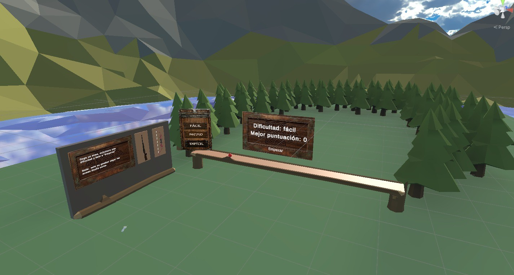
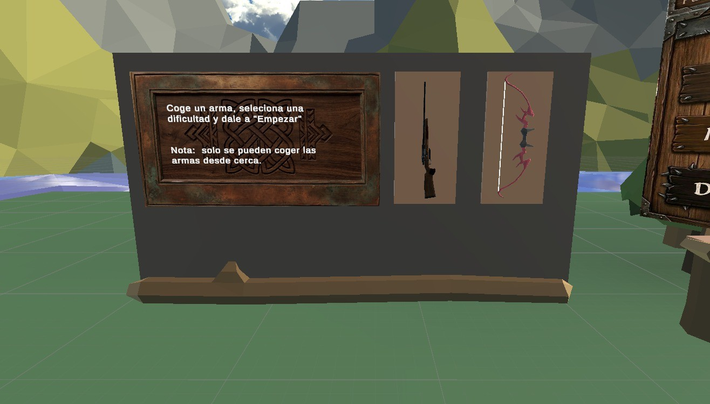
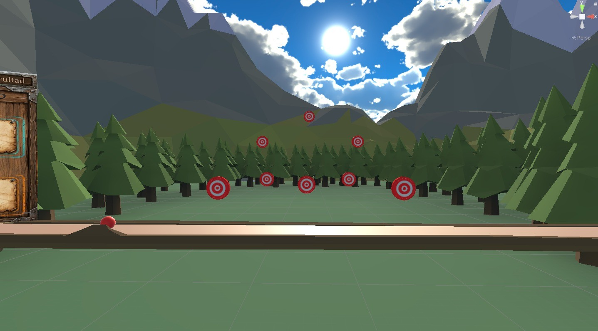
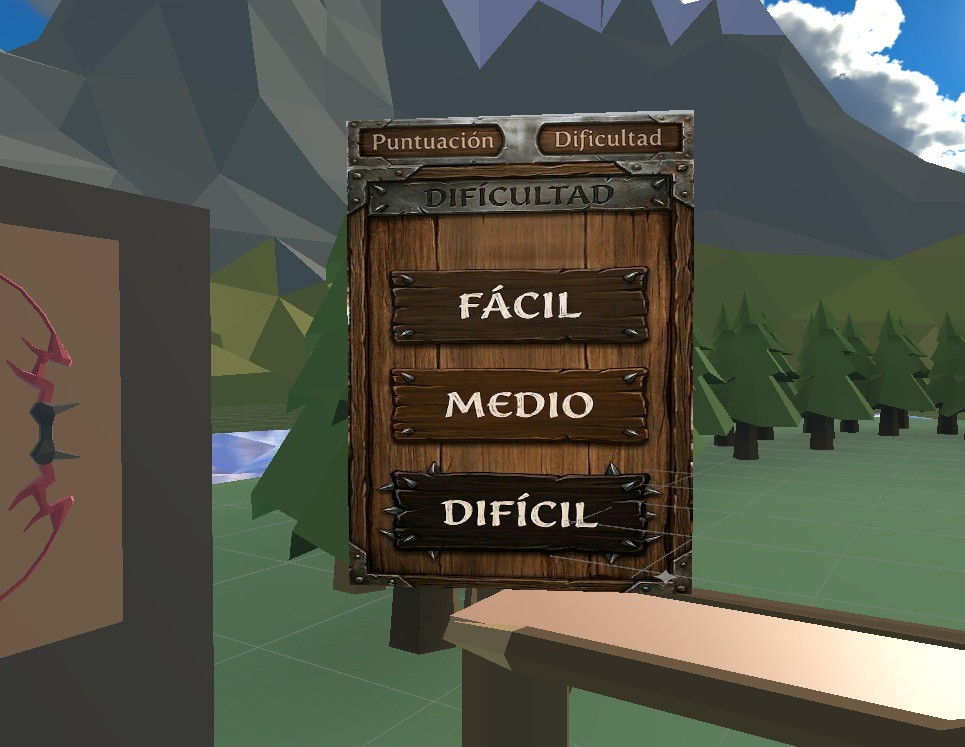
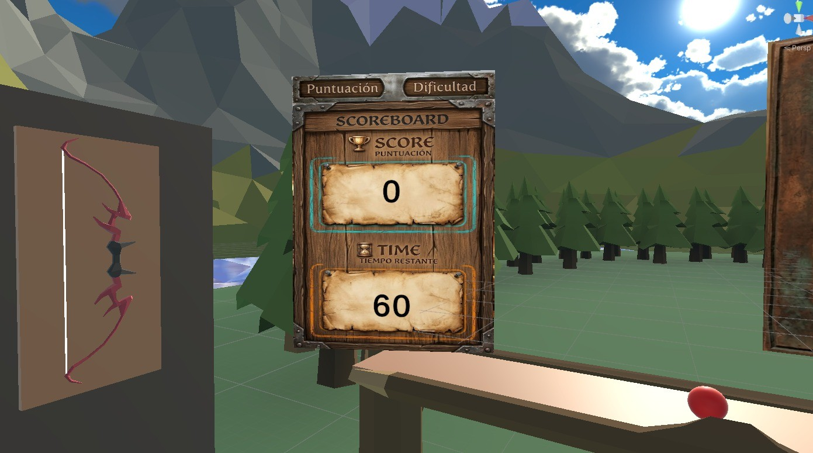
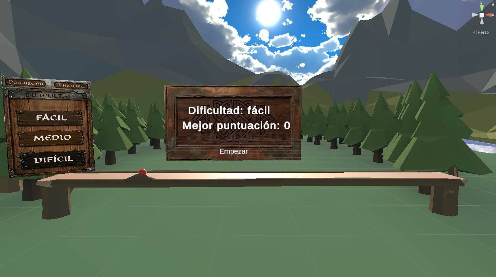
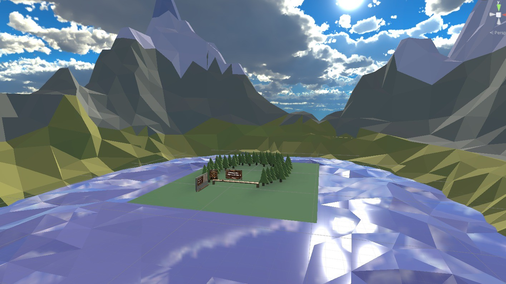

# Realidad Virtual y Mixta

Proyecto de **Unity** desarrollado con el **XR Interaction Toolkit (XRI)** que contiene dos experiencias de disparo sobre dianas:

1. **Realidad Virtual (VR):** zona de juego tipo "Caseta de Feria" con **arco** y **francotirador/pistola** para practicar puntería, incluyendo un minijuego donde las dianas reaparecen y la puntuación se acumula al acertar.
2. **Realidad Mixta (MR):** adaptación de la experiencia anterior en la que las dianas aparecen por los diferentes puntos de la habitación en la que te encuentres, ancladas a la malla del entorno.

## Descripción general

El proyecto permite al jugador ponerse a prueba en puntería con dos armas distintas dentro de una zona de juego tipo caseta de feria:

* **Arco:** se agarra la estructura del arco con un mando y la cuerda con el otro. Se tensa la cuerda para regular la potencia del disparo y se suelta para lanzar la flecha. Cuanto más se tensa, más lejos y rápido viaja la flecha. **Se requieren ambos mandos** (uno para el arco, otro para la cuerda). Cada flecha se autodestruye tras 5 segundos.
* **Francotirador / pistola:** disparo instantáneo por rayo (raycast). Al impactar en una diana, se extrae su componente `Dart` y se ejecuta la función `Interact` para que la diana explote y sume puntos.

Ambas escenas comparten el mismo objetivo: **acertar a las dianas para sumar puntos** dentro de un tiempo limitado.

---

## Escenas incluidas

| Escena | Tipo | Descripción |
|--------|------|-------------|
| `EscenaCasetas` / `BasicScene` | **VR** | Zona de tiro al estilo feria. Incluye arco y pistola/francotirador, dianas que reaparecen tras ser destruidas, temporizador de 60 s, marcador de puntuación y mejor puntuación. Tres niveles de dificultad (Fácil, Media, Difícil). |
| `MixedReality` | **MR** | Versión adaptada a realidad mixta. Las dianas se instancian en puntos válidos de la malla de la habitación (paredes, superficies detectadas) y el jugador debe moverse físicamente por el espacio para encontrarlas y dispararles. |

---

## 📸 Capturas del proyecto

A continuación se incluyen las capturas extraídas de los documentos de diseño del proyecto.

### 🕹️ Controles y sistema de juego (Caseta de Feria VR)








---

## Mecánicas de juego

### Minijuego de puntería (VR - Caseta de Feria)

* **Temporizador de partida:** 60 segundos.
* Al acertar una diana, los puntos se suman automáticamente al marcador.
* La diana golpeada desaparece y **reaparece tras un breve intervalo** para seguir jugando hasta que se acabe el tiempo.
* Se registra la **mejor puntuación** alcanzada.
* **Dificultad ajustable** (Fácil / Media / Difícil) que afecta a la velocidad de movimiento de las dianas. Solo se puede cambiar antes de iniciar la partida.
* El temporizador se pone en **rojo cuando quedan 10 segundos o menos**.

### Arco (VR)

* Se utiliza **ambos mandos**: uno para sujetar el arco y otro para tensar la cuerda.
* La fuerza del disparo depende de cuánto se tense la cuerda (a mayor tensión, mayor velocidad y alcance).
* La dirección de la flecha se determina por la orientación del arco en el momento de soltar la cuerda.
* Cada flecha se autodestruye tras 5 segundos si no impacta.

### Francotirador / Pistola (VR)

* Disparo por rayo (raycast) desde un punto local del arma.
* Al impactar en una diana, se ejecuta el evento `OnDartHit` y la función `Interact` de la diana para sumar puntos y destruirla con efectos visuales.

### Realidad Mixta (MR)

* El sistema escanea el entorno mediante **AR Foundation** y genera una lista de puntos válidos sobre la malla de la habitación (`ARMeshAnalyzer`).
* Se filtran los puntos determinando si están demasiado cerca y si sus **normales corresponden a paredes**, para que las dianas se instancien mirando hacia el jugador.
* Las dianas aparecen en **posiciones aleatorias por la habitación** (paredes, superficies detectadas).
* Máximo de **10 dianas activas simultáneamente**.
* Las flechas del arco se quedan **clavadas en el entorno 3D** (se añade un `meshCollider` a la malla; al colisionar, la velocidad de la flecha se neutraliza y se pone en modo kinematic, convirtiéndose en hija de la malla).

---

## Controles (sistema XR)

| Acción | Control |
|--------|---------|
| Moverse / mirar | Joystick o trackpad del mando izquierdo; gira la cabeza para mirar alrededor |
| Teletransportarse | Apunta hacia el suelo y pulsa el joystick |
| Agarrar el arco | Acercar el mando al arco y pulsar el gatillo |
| Tensar la cuerda del arco | Con el otro mando, agarrar la cuerda y tirar hacia atrás |
| Disparar flecha | Soltar el gatillo del mando de la cuerda |
| Agarrar la pistola/francotirador | Acercar el mando al arma y pulsar el gatillo |
| Disparar pistola | Pulsar el gatillo del mando |
| Seleccionar dificultad | Interactuar con el menú antes de iniciar la partida |
| Iniciar partida | Pulsar el botón de inicio en el panel de puntuación |

> Los controles están basados en el **XR Interaction Toolkit** de Unity y funcionan con mandos de realidad virtual estándares (Meta Quest, Pico, etc.).

---

## Estructura del proyecto

```
Assets/
├── Scenes/
│   ├── EscenaCasetas.unity        # Escena VR principal (zona de juego / caseta de feria)
│   ├── BasicScene.unity
│   ├── MixedReality.unity         # Escena de realidad mixta
│   └── SampleScene.unity
├── Scripts/
│   ├── Bow/
│   │   ├── BowStringController.cs # Control de cuerda y potencia del arco (eventos OnBowPulled / OnBowRelease)
│   │   ├── ArrowController.cs     # Instanciación y lanzamiento de flechas (recibe evento OnBowPulled)
│   │   └── Arrow.cs
│   ├── DartSistem/
│   │   ├── Dart.cs                # Logica de diana, puntuación y efectos de rotura (evento OnDartHit)
│   │   ├── DartManager.cs         # Gestor del minijuego VR (tiempo, puntuación, dificultad)
│   │   └── DartMovement.cs
│   ├── MixedVR/
│   │   ├── DartManagerAR.cs       # Gestor MR (dianas por la habitación, malla AR)
│   │   ├── ARMeshAnalyzer.cs      # Procesamiento de malla del entorno (puntos y normales de paredes)
│   │   └── SpawnWeapon.cs         # Posicionamiento de arma relativa al jugador
│   ├── MachineManager.cs          # Gestor de puntuación y temporizador (VR)
│   ├── TopoManager.cs / Topo.cs   # Minijuego tipo "topo" (dianas que aparecen y desaparecen)
│   ├── Shoot.cs (XRGun)           # Disparo por rayo con pistola/francotirador
│   ├── PullInteraction.cs         # Interacción de tensar cuerda del arco
│   └── Destroy.cs
├── Prefabs/
│   ├── Bow/                       # Prefabs del arco, cuerda y flecha
│   ├── Gun/                       # Prefabs de la pistola/francotirador y proyectiles
│   ├── Dart/                      # Prefabs de diana
│   ├── Ballon/
│   ├── AR/
│   └── XR Origin (XR Rig).prefab  # Rig de realidad virtual
└── XR/                            # Perfiles de entrada y configuración XR
```

---

## Requisitos

* **Unity 2022 LTS** o superior (recomendado 2022.3+)
* Módulos de Unity: **Android Build Support**, **Windows Build Support** (según plataforma destino)
* Paquetes instalados (ya incluidos en `Packages/`):
  * XR Interaction Toolkit
  * AR Foundation (para la escena de realidad mixta)
  * TextMesh Pro
  * Universal Render Pipeline (URP)

### Hardware recomendado
* Gafas de realidad virtual/mixta compatibles con OpenXR (Meta Quest 2/3/3S, Pico 4, etc.)
* PC con GPU compatible con Unity y realidad virtual para editor

---

## Cómo ejecutar el proyecto

1. Clona o descarga este repositorio.
2. Abre **Unity Hub** y añade el proyecto seleccionando la carpeta raíz.
3. Abre la escena deseada desde `Assets/Scenes/`:
   * `EscenaCasetas.unity` → modo Realidad Virtual
   * `MixedReality.unity` → modo Realidad Mixta
4. Conecta tus gafas VR/MR y activa el modo **Play** en Unity, o compila el proyecto para tu plataforma de destino (Android / Windows).

> En la escena de realidad mixta asegúrate de conceder los permisos de **espacial / malla del entorno** en el dispositivo antes de iniciar la partida.

---

## Documentación de referencia

Este proyecto se ha desarrollado a partir de la documentación de diseño del proyecto:

* `L1G8_Controles_Sistema_Juego.pdf` — manual de usuario con controles básicos, mecánicas del arco y la pistola, niveles de dificultad, puntuación y solución de problemas comunes.
* `Proyecto Realidad Aumentada.pdf` — documento detallado de implementaciones de realidad mixta: objetos interactivos, colocación sobre pedestales mediante socket (`XRSocket Interactor`), temporizador y puntuación, aparición aleatoria de objetivos en paredes mediante análisis de malla, flechas clavadas en el entorno, iluminación y sombras.
* `L1G8 IM RV.pdf` — guía de inmersión y realidad virtual.
---

## Características destacadas

* ✅ Dos escenas independientes: VR (Caseta de Feria) y Realidad Mixta
* ✅ Arco con tensión de cuerda física, potencia variable y uso de ambos mandos
* ✅ Pistola / francotirador con disparo por rayo, efectos visuales y de sonido
* ✅ Minijuego de puntería con puntuación, temporizador y mejor puntuación
* ✅ Diana reactiva: se destruye al acertar y reaparece automáticamente
* ✅ Dificultad configurable (Fácil / Media / Difícil)
* ✅ Realidad mixta con generación de dianas sobre la malla real de la habitación (paredes y superficies)
* ✅ Flechas que se quedan clavadas en el entorno 3D
* ✅ Colocación de armas sobre pedestales mediante `XRSocket Interactor`
* ✅ Interfaz de usuario con TextMesh Pro (puntuación, temporizador, dificultad)

---